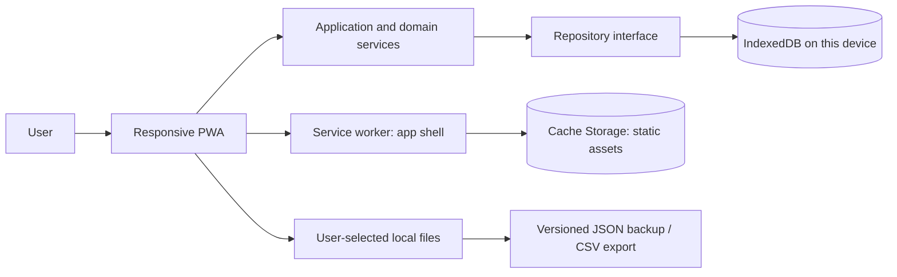
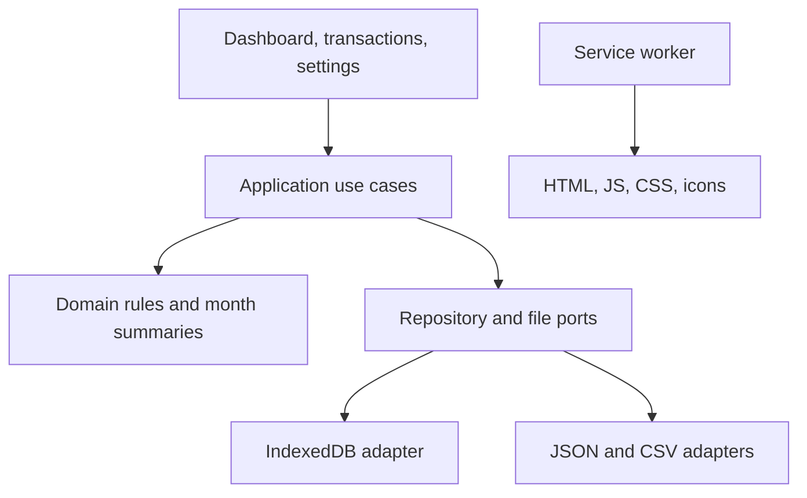

# Architecture: POTFOLIOO

**Status:** Proposed MVP architecture  
**Version:** 1.0  
**Date:** 2 November 2026

## 1. Direction

Build a responsive, installable Progressive Web App (PWA) for modern mobile and desktop browsers. Bundle the UI and domain logic with the app, use IndexedDB for transaction persistence, a service worker to cache the application shell, and explicit local file export/import for portability.

There is no server dependency for the MVP. Each browser profile/device has its own database. This avoids requiring accounts or connectivity but means data will not sync automatically.

## 2. System context



No financial data should be stored in service-worker caches, URLs, browser logs, or analytics.

## 3. Suggested stack

Use TypeScript with a mature web framework (for example React with Vite, or the framework already used by the repository). Keep domain and persistence code framework-independent.

- IndexedDB directly or via a small maintained typed wrapper such as Dexie.
- A manifest and service-worker integration maintained for the selected build stack.
- Integer minor units for monetary arithmetic, with currency-aware parsing and `Intl.NumberFormat` display.
- A form library only if it reduces complexity; keep business validation explicit.
- Select exact versions during implementation after checking maintenance, security, and browser support.

## 4. Logical modules



- **Presentation:** Accessible responsive screens; no direct IndexedDB calls.
- **Application/use cases:** Create, update, delete, list, summarize, export, and restore operations.
- **Domain:** Transaction invariants, amount parsing, and deterministic monthly calculations.
- **Repository port:** Typed boundary for books, transactions, and optional categories.
- **IndexedDB adapter:** Schema/version upgrades, indexes, atomic transactions, and error translation.
- **Backup adapters:** Versioned JSON validation/serialization and safe CSV output.
- **Service worker:** Cache versioned static assets only and provide an offline fallback.

## 5. Data model

### Business Hierarchy
```
User / Profile
  └── Business Membership (Role: owner | admin | accountant | employee)
        └── Business (Name, Type, Category, Base Currency, Financial Year, Accounting Prefs)
              ├── Books
              ├── Inventory Items & Stock Alerts
              ├── Transactions & Payments
              ├── Customers & Tenants
              └── Suppliers & Vendors
```

### Business

| Field | Type | Notes |
|---|---|---|
| `id` | UUID string | Primary key |
| `name` | string | Business trading name |
| `type` | string | `retail` \| `rental` \| `services` \| `general` |
| `category` | string | Primary accounting category (`retail` \| `rental` \| `other`) |
| `currencyCode` | ISO 4217 string | Default base currency (`TZS`) |
| `location` | string | Tanzanian administrative region (e.g. `Dar es Salaam`, `Arusha`) |
| `address` | string or null | Physical street address |
| `financialYearStart` | string | `01-01` (Calendar) \| `07-01` (Fiscal) |
| `accountingPreferences` | JSON object | Accounting basis (`cash` \| `accrual`) & VAT registration |

### Business Member

| Field | Type | Notes |
|---|---|---|
| `id` | UUID string | Primary key |
| `businessId` | UUID string | Foreign key to `businesses(id)` |
| `userId` | UUID string | Foreign key to `profiles(id)` |
| `role` | string | `owner` \| `admin` \| `accountant` \| `employee` |
| `permissions` | JSON array | Explicit access permissions (e.g. `["all"]`) |

### Book

| Field | Type | Notes |
|---|---|---|
| `id` | UUID string | Stable book ID, retained in backup |
| `businessId` | UUID string or null | Foreign key to parent `businesses(id)` |
| `name` | string | Required, user editable, length-limited |
| `category` | string | `retail` \| `rental` \| `other` |
| `currencyCode` | ISO 4217 string | One currency (`TZS` default); changes do not convert existing values |
| `createdAt`, `updatedAt` | ISO timestamps | UTC instants |
| `schemaVersion` | integer | Model version for migrations and backup |

### Inventory Item

| Field | Type | Notes |
|---|---|---|
| `id` | UUID string | Primary key |
| `bookId` | UUID string | Foreign key to `books(id)` |
| `businessId` | UUID string or null | Foreign key to `businesses(id)` |
| `name` | string | Product / item name |
| `currentQuantity` | float | Available physical inventory quantity |
| `avgPurchasePriceMinor` | integer | Weighted average purchase cost per unit in minor units |
| `status` | string | `in_stock` \| `low_stock` \| `empty` |

### Transaction

| Field | Type | Notes |
|---|---|---|
| `id` | UUID string | Primary key |
| `bookId` | UUID string | Foreign key to `books(id)` |
| `businessId` | UUID string or null | Foreign key to `businesses(id)` |
| `type` | `income` \| `expense` | Explicit; never infer from sign |
| `amountMinor` | integer | Positive integer in currency minor units |
| `transactionDate` | `YYYY-MM-DD` | Calendar date, not midnight UTC |
| `category`, `note` | string or null | Optional, length-limited plain text |
| `paymentMethod` | string or null | `cash` \| `phone` (M-Pesa) \| `bank` |
| `itemId`, `quantitySold`, `cogsMinor` | varied | Retail sale specific attribution |
| `tenantName`, `unitNumber`, `rentDueDate` | varied | Rental property specific attribution |
| `createdAt`, `updatedAt` | ISO timestamps | UTC instants |

Store date-only values as strings so timezone conversion cannot move an entry to an adjacent date. Index by book, transaction date, and type to support month/list queries. The MVP may store category labels directly on transactions; a separate category store can be added later.

## 6. Money and reporting rules

- Use the selected currency's fraction digits for input validation. If implementation initially supports two decimal places only, constrain/document the currency set.
- Parse amounts with decimal-safe logic, convert once to integer minor units, and sum integers only.
- Format with `Intl.NumberFormat` using the book's currency.
- Store income and expense as positive amounts with explicit type. Compute net as income minus expenses.
- Represent selected month by local calendar year/month. Query date-only bounds from the first through final day of month; do not use UTC timestamp boundaries.
- Use a single summary use case for all dashboard totals.

## 7. Persistence and schema migration

- Initialize IndexedDB through a repository factory at startup.
- Use explicit schema versions and incremental, idempotent migrations.
- Make related writes atomic where possible.
- On failed writes, preserve form input and report that the entry was not saved.
- Handle unavailable storage, blocked database upgrades, and quota errors visibly.
- Do not silently fall back to `localStorage`; its limits and query behavior are unsuitable as a hidden substitute.
- Request persistent storage opportunistically where supported, but never imply it is guaranteed.

## 8. Backup and restore

Use a versioned JSON envelope, for example:

```json
{
  "format": "potfolioo-backup",
  "formatVersion": 1,
  "exportedAt": "2026-11-02T10:00:00.000Z",
  "book": { "id": "...", "name": "My Book", "currencyCode": "USD" },
  "transactions": []
}
```

Restore flow:

1. Read the selected file locally with a reasonable size limit.
2. Validate format/version, required fields, lengths, IDs, dates, currency, and positive integer amounts.
3. Reject duplicate IDs, invalid dates, and unsupported future versions without mutation.
4. Preview book name, currency, backup time, and transaction count.
5. Require confirmation to replace the current local book.
6. Replace records in one IndexedDB transaction; show success only after commit.
7. Refresh visible state from the repository.

CSV export must quote and escape values, include date/type/currency headers, and neutralize spreadsheet formula prefixes in text fields.

## 9. Offline and installability

- Precache the application shell and version static caches; remove obsolete shell caches on activation.
- Core data operations make no required network requests. A failed network must not block the app.
- Communicate offline readiness accurately, especially before the first cache is established.
- Test install behavior per target browser; remain usable as a normal web app where install is unavailable.
- Browser clearing, private browsing, profile changes, and device loss can remove data. Manual backup is the cross-device path.

## 10. Privacy and security

- No authentication is needed for the local-only MVP. Device protection comes from the OS/browser profile.
- Do not claim app-level encryption at rest. If required later, rely on OS encryption or scope a separate encrypted-backup feature.
- Render notes/categories as text. Validate imported data and never execute imported content.
- Do not log financial values, notes, or backup contents. Any future diagnostics must be opt-in and scrubbed.
- Treat backups as untrusted input; limit sizes and field lengths and use atomic writes.

## 11. Failure behavior

- **Database open failure:** Explain that records cannot currently be saved and provide recovery guidance.
- **Write/quota failure:** Preserve the form and show a save failure, with storage recovery advice where useful.
- **Invalid backup:** Explain the problem and preserve all current data.
- **Restore write failure:** Roll back and retain current records.
- **Unsupported backup version:** State that this version cannot read it and make no changes.
- **Offline:** Core features continue; only nonessential external destinations may be unavailable.

## 12. Decisions and trade-offs

| Decision | Benefit | Trade-off |
|---|---|---|
| Responsive PWA | Shared phone/PC codebase, app-shell offline use | Storage is device/profile specific; install support varies |
| IndexedDB | Structured durable browser storage, indexes, transactions | Quotas and lifecycle behavior need handling |
| Integer minor units | Accurate sums and clear formatting | Currency precision must be handled correctly |
| Manual JSON backup | No server/account required; portable | User performs export/import and protects backup file |
| Cash-basis, single currency | Simple monthly net calculation | Not suitable for accrual or multi-currency accounting |

## 13. Extension points

Multiple local books, encrypted backups, conflict-aware optional sync, CSV import with preview/duplicate detection, recurring entries, attachments, richer reporting, and native wrappers can be considered after MVP validation.
