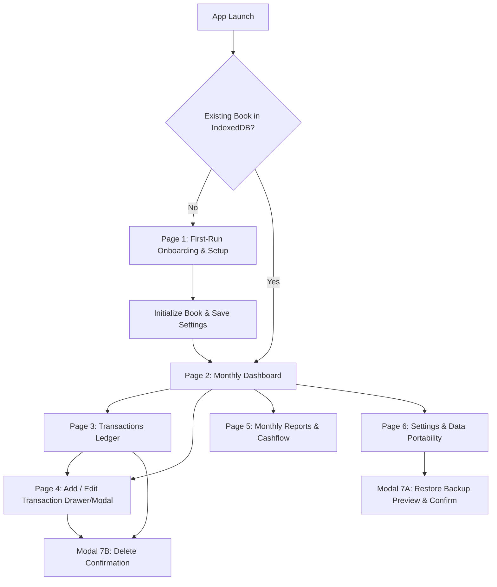

# POTFOLIOO — Pages & Component Inventory

**Version:** 1.0  
**Date:** 2 November 2026  
**Status:** Approved for Implementation & UI Generation  
**Design System Reference:** [DESIGN.md](file:///c:/Users/DELL/Downloads/POTFOLIOO/DESIGN.md)  
**System Architecture Reference:** [ARCHITECTURE.md](file:///c:/Users/DELL/Downloads/POTFOLIOO/ARCHITECTURE.md)  
**Product Requirements Reference:** [PRD.md](file:///c:/Users/DELL/Downloads/POTFOLIOO/PRD.md)

---

## 1. Information Architecture & Page Map

POTFOLIOO is structured as an offline-first, single-book Progressive Web App (PWA). The interface operates seamlessly across phone viewports (360px–420px mobile-first) and desktop screens (max 1200px centered).



### Complete Page Catalog

| ID | Page / View Name | Route / State | Target Viewport | Primary Responsibility |
|---|---|---|---|---|
| **PG-01** | **First-Run Onboarding** | `/setup` (or conditional root) | Mobile & Desktop | Explains local storage boundary, collects book name (default "My Book"), confirms currency code, initializes IndexedDB. |
| **PG-02** | **Monthly Dashboard** | `/` or `/dashboard` | Mobile & Desktop | Central cockpit. Month switcher, Net Profit/Loss hero card, Income/Expense split cards, Recent activity feed, Quick "+ Add" CTA. |
| **PG-03** | **Transactions Ledger** | `/transactions` | Mobile & Desktop | Full transaction history with search by note/category, month selector, Income/Expense filter chips, and edit/delete row actions. |
| **PG-04** | **Add / Edit Transaction** | `/transactions/new` or `/transactions/:id` (Modal/Drawer) | Mobile & Desktop Drawer | Focused data capture: Segmented Type (Income/Expense), Amount in minor units, Date picker, Category text, Note text, Save/Cancel. |
| **PG-05** | **Monthly Reports** | `/reports` | Mobile & Desktop | Analytical view: Month-over-month comparison, Cash flow breakdown, Category spending rankings, visual bar breakdown (Royal Blue vs Nitro Orange). |
| **PG-06** | **Settings & Portability** | `/settings` | Mobile & Desktop | Book settings, Currency selector (with non-conversion warning), JSON Backup Export, JSON Restore flow, CSV Export, Local-only privacy note. |
| **PG-07A** | **Restore Preview Modal** | Overlay / Dialog | Universal Dialog | Inspects uploaded JSON file, previews Book Name, Currency, Timestamp, Transaction Count; prompts explicit replacement confirmation. |
| **PG-07B** | **Delete Confirm Dialog** | Overlay / Dialog | Universal Dialog | Guards destructive transaction deletion, provides clear cancel and confirm options with undo guidance. |

---

## 2. Component Inventory (Atomic Design Hierarchy)

Following the neo-brutalist visual language specified in [DESIGN.md](file:///c:/Users/DELL/Downloads/POTFOLIOO/DESIGN.md):
- **Outlines:** 2px solid Blackstone (`#171717`)
- **Shadows:** Hard offset `4px 4px 0 #171717` (prominent) and `3px 3px 0 #171717` (compact)
- **Palette:** Warm Canvas (`#FFFDF8`), Pure White Surface (`#FFFFFF`), Slate Navy (`#33415C`), Vivid Amber (`#FFA200`), Citron Lime (`#BFD200`), Electric Sky (`#48CAE4`), and Blackstone (`#171717`).

```
└── UI Component Library
    ├── Tokens (Colors, Spacing, Typography, Shadows, Borders)
    ├── Atoms
    │   ├── AT-BTN: Action Buttons (Primary, Secondary, Destructive, Icon)
    │   ├── AT-INP: Form Inputs (Text, Currency Amount, Date, Textarea)
    │   ├── AT-TYP: Typography Tokens (MoneyLarge, MoneyStandard, Headings)
    │   ├── AT-BDG: Badges & Pills (Status, Filter Chip, Type Tag)
    │   ├── AT-ICO: Icon Tiles (44px/48px solid fill with Blackstone outline)
    │   └── AT-DIV: Dividers & Structural Borders
    ├── Molecules
    │   ├── ML-SEG: Segmented Control (Income / Expense Switcher)
    │   ├── ML-NAV-MONTH: Month Switcher Carousel (Prev, Current Month, Next)
    │   ├── ML-FLD-GRP: Form Field Container (Label + Input + Inline Error)
    │   ├── ML-SRCH: Search & Filter Chip Bar
    │   ├── ML-ROW-TXN: Transaction List Row Item
    │   ├── ML-PILL-OFFLINE: Offline Persistence Status Pill
    │   └── ML-ALERT: Inline Alert / Toast Notification
    ├── Organisms
    │   ├── OG-NAV-BAR: Top Header Chrome / Desktop Nav Bar
    │   ├── OG-NAV-BOT: Mobile 4-Item Floating / Docked Tab Bar
    │   ├── OG-HERO-NET: Net Profit / Loss Visual Anchor Card
    │   ├── OG-CARD-DUO: Income & Expense Summary Duo Cards
    │   ├── OG-FEED-TXN: Recent Activity Feed with Empty State
    │   ├── OG-TABLE-TXN: Full Transactions Ledger Table / Stacked List
    │   ├── OG-FORM-TXN: Add / Edit Transaction Form Card
    │   ├── OG-SET-GROUP: Settings & Data Backup Card Stack
    │   └── OG-MODAL: Dialog Container (Restore Preview & Delete Confirm)
    └── Templates / Layouts
        ├── TL-APP-MOBILE: Mobile PWA Shell (Safe-area header, scroll canvas, bottom tab bar)
        └── TL-APP-DESKTOP: Desktop Chassis (1200px centered max-width, top nav, multi-column grid)
```

---

### Detailed Component Specifications

#### A. Atoms (Fundamental Elements)

| Component Code | Component Name | Props / Variants | Visual Style & Behavior |
|---|---|---|---|
| `AT-BTN-PRI` | **Primary Button** | `label`, `icon`, `disabled`, `loading` | Height 48px, Slate Navy (`#33415C`) fill, Blackstone 2px border, white label, 4px offset shadow. Active: shifts 2px towards shadow. |
| `AT-BTN-SEC` | **Secondary Button** | `label`, `icon`, `accent` | Height 48px, Surface (`#FFFFFF`) fill, Blackstone 2px border, Blackstone text, 3px offset shadow. |
| `AT-BTN-DES` | **Destructive Button** | `label`, `icon` | Surface (`#FFFFFF`) with Danger text (`#B42318`), 2px border `#B42318` or Blackstone, 3px shadow. |
| `AT-BTN-ICO` | **Icon Action Button** | `iconName`, `ariaLabel`, `size` | 44x44px touch target, Surface `#FFFFFF`, Blackstone 2px border, 3px hard shadow. Visible focus ring. |
| `AT-INP-TXT` | **Text Input** | `placeholder`, `value`, `maxLength`, `error` | Height 48-56px, Surface `#FFFFFF`, 2px Blackstone border, 12px radius, Manrope 16px. Error: Danger border + inline text. |
| `AT-INP-MONEY`| **Currency Amount Input**| `currencyCode`, `minorUnits`, `value` | Large tabular numerals (`28px–32px`), prefixed/suffixed with currency symbol (`$`, `€`, `£`), isolated integer/decimal parsing. |
| `AT-INP-DATE` | **Calendar Date Input** | `value`, `min`, `max` | Height 48-56px, Native date picker with calendar icon, formats strictly to `YYYY-MM-DD` string to avoid UTC offset bugs. |
| `AT-ICO-TILE` | **Visual Icon Tile** | `icon`, `variant: [income, expense, neutral, dark]` | 44x44px or 48x48px square, 10px radius, 2px Blackstone outline, 3px offset shadow. Fills: Citron Lime (`#BFD200`), Vivid Amber (`#FFA200`), Slate Navy (`#33415C`), or Electric Sky (`#48CAE4`). |
| `AT-BDG-TYPE` | **Type Pill Tag** | `type: [income, expense]` | Fully rounded (`9999px`), 12px font, bold text, Income: Citron Lime Tint (`#F7FAE4`) with `#171717`; Expense: Vivid Amber Tint (`#FFF3DF`) with `#171717`. |
| `AT-BDG-STAT` | **Status / Trend Pill**| `label`, `status: [profit, loss, neutral]` | High-contrast capsule with Blackstone outline, displays "Profit" (Lime/Sky highlight) or "Loss" (Amber highlight). |

---

#### B. Molecules (Composed Units)

| Component Code | Component Name | Composition & Description |
|---|---|---|
| `ML-SEG-TYPE` | **Type Segmented Switcher** | Two full-width toggle buttons in a unified track: `[ + Income ]` and `[ - Expense ]`. Active Income has Citron Lime (`#BFD200`) border/tint; Active Expense has Vivid Amber (`#FFA200`) border/tint. Check icon on active state. |
| `ML-NAV-MONTH` | **Month Carousel Switcher** | Centered month banner (e.g. "November 2026") flanked by `[ ← Previous Month ]` and `[ Next Month → ]` tactile icon buttons. Includes "Today / Current" quick reset chip. |
| `ML-FLD-GRP` | **Accessible Form Group** | Stacked vertical group: Semantic `<label>` with required asterisk → Atom Input (`AT-INP-*`) → Helper text or `<span role="alert">` validation message. |
| `ML-SRCH-BAR` | **Search & Filter Bar** | Search input for descriptions/notes combined with a horizontal row of filter chips: `[ All (18) ]`, `[ Income (8) ]`, `[ Expense (10) ]`. |
| `ML-ROW-TXN` | **Transaction Row Item** | Clickable row: Left `AT-ICO-TILE` (Blue arrow-down for income, Orange arrow-up for expense) → Column (Title/Category, Date, Note) → Right Column (Tabular Amount `+$1,200.00` or `-$45.50`, explicit Type Pill). Separated by 1px Border Subtle (`#D9D6CE`). |
| `ML-PILL-OFFLINE`| **Offline Status Pill** | Compact status capsule (`9999px`): 6px green indicator dot + "Local Book • Offline Ready" in Caption font. Clickable to view storage explanation. |
| `ML-ALERT` | **Feedback Alert / Toast** | Dismissible notification banner: 2px Blackstone outline, 3px shadow, Success (`#237A45`) or Danger (`#B42318`) icon, aria-live polite announcement. |

---

#### C. Organisms (Complex Structural Blocks)

| Component Code | Component Name | Elements & Behavioral Logic |
|---|---|---|
| `OG-NAV-BAR` | **Header Chrome** | Displays Book Title ("My Book" with edit icon), `ML-PILL-OFFLINE`, and Settings gear icon button. Desktop includes route links. |
| `OG-NAV-BOT` | **Mobile Bottom Bar** | Fixed bottom navigation: 4 tabs with 24px icons and labels: `Dashboard`, `Transactions`, `Reports`, `Settings`. Selected tab highlighted with Electric Sky (`#48CAE4`) fill & Blackstone outline. |
| `OG-HERO-NET` | **Net Profit Hero Card** | Major visual anchor. 2px Blackstone outline, 4px offset shadow, 16px radius, Surface `#FFFFFF`. Displays: Selected Month label, massive tabular Net Amount (`Money Large` 36px), "Net Profit" or "Net Loss" status badge, and transaction count. |
| `OG-CARD-DUO` | **Monthly Duo Cards** | Pair of cards (stacked on phone, 2-col on desktop):<br>1. **Total Income:** Royal Blue icon tile, "Total Income" label, large tabular sum, transaction count.<br>2. **Total Expenses:** Nitro Orange icon tile, "Total Expenses" label, large tabular sum, transaction count. |
| `OG-FEED-TXN` | **Recent Transactions Feed**| Top 5 transactions for the month, "Recent Activity" header with "See all (18) →" link to `/transactions`. Includes tactile Empty State if count is 0. |
| `OG-TABLE-TXN` | **Transactions Ledger** | Virtualized list (Mobile stacked rows, Desktop 4-column table: Date, Category/Description, Type, Amount, Actions). Fast filtering with instant recalculation. |
| `OG-FORM-TXN` | **Add/Edit Transaction Form**| Complete form layout with `ML-SEG-TYPE`, amount input with currency symbol, date picker, category suggestion chips, note textarea, sticky primary "Save" button. |
| `OG-SET-GROUP` | **Settings Card Stack** | Stack of cards: 1. Book Details (Name & Currency), 2. Backup & Export (JSON Download, CSV Download), 3. Restore Ledger (Upload JSON & Preview), 4. Device Storage & Privacy Explainer. |
| `OG-MODAL` | **Universal Modal Sheet** | Backdrop overlay (`rgba(23,23,23,0.6)`), centered modal card (desktop) or slide-up bottom sheet (mobile), 2px outline, 4px shadow, sticky header with close button. |

---

## 3. Responsive Breakpoints & Viewport Rules

| Viewport Name | Width Range | Layout Strategy |
|---|---|---|
| **Compact Mobile (Default)** | 360px – 480px | Single-column fluid layout. 16px horizontal margins (`--space-4`). Sticky bottom navigation bar (64px height). Floating or header "+ Add" CTA. Stacked summary cards. |
| **Tablet / Wide Mobile** | 481px – 840px | 24px margins. Two-column grid for Income & Expense duo cards. Transactions display category and note side-by-side. |
| **Desktop / Laptop** | 841px – 1200px+ | Max-width content chassis pinned to 1200px centered with 32px gutters. Top navigation bar replaces bottom bar. Dashboard displays 3 summary cards in a single row. Ledger renders as a structured tabular data grid. |

---

## 4. Accessibility & Interaction Specs (WCAG 2.2 AA)

1. **Color Independence:** Income (Blue) and Expense (Orange) are accompanied at all times by:
   - Text labels ("Income", "Expense", "Profit", "Loss").
   - Directional icons (Arrow down/in for income, Arrow up/out for expense).
   - Plus/minus mathematical signs (`+` and `-`).
2. **Keyboard Navigation:** High-contrast 3px Royal Blue focus ring (`offset 2px`) on all interactive controls (`a`, `button`, `input`, `select`).
3. **Touch Targets:** All interactive buttons, chips, and table row selectors have minimum dimensions of 48px × 48px (strictly exceeding 44px AA minimum).
4. **Live Announcements:** Dynamic updates (saving transactions, deleting entries, restore success, quota errors) trigger an `aria-live="polite"` region.
5. **No Data Loss on Form Error:** Form validation errors are rendered inline without wiping entered amount, date, or notes.
