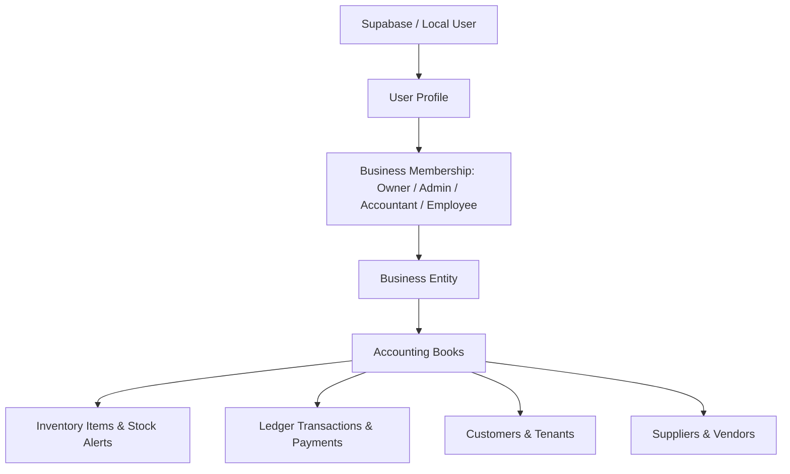

# POTFOLIOO 📊

> **Smart Bookkeeping & Cash Flow Management for Growing Businesses and Sole Proprietors.**  
> Designed with an offline-first architecture, Tanzanian Shilling (TZS) native support, neo-brutalist tactile UI, and enterprise-grade multi-tenant security.

---

## 🌟 Highlights & Capabilities

- 🇹🇿 **Tanzanian SME Native**: Whole-number Tanzanian Shilling (`TSh 1,000,000`) formatting, Tanzanian administrative region presets, and TRA VAT toggles.
- 📦 **Retail & Wholesale Inventory**: Real-time stock status monitoring, weighted-average purchase cost tracking, cost of goods sold (COGS) arithmetic, and payment method attribution (Cash, Mobile Money / M-Pesa, Bank).
- 🏢 **Rental Property Management**: Unit occupancy, tenant payment tracking, overdue rent indicators, and native phone dialer integration.
- 🎨 **Neo-Brutalist Visual Identity**: 2px Blackstone borders, 4px/8px brutal drop shadows, tactile button physics, and high-contrast color hierarchy (`#33415C` Slate Navy, `#BFD200` Citron Lime, `#FFA200` Vivid Amber, `#48CAE4` Electric Sky, `#A678B9` Purple Accent).
- ⚡ **Offline-First Progressive Web App (PWA)**: Full local persistence using Dexie IndexedDB with service worker caching. Operates with zero connectivity.
- 🛡️ **Enterprise Security & PostgreSQL RLS**: Multi-tenant database model (`User -> Profile -> Business Membership -> Business -> Records`) with Row Level Security (RLS) policies enforcing business boundary isolation.
- 📄 **Multi-Format Export**: Generates printable vector PDFs (PDF 1.4) and formatted Microsoft Excel workbooks (`.xlsx`) with payment breakdowns.
- 🎮 **Isolated Interactive Demo**: Instant exploration with realistic Tanzanian sample data (*Kariakoo Wholesalers Co.* and *Mikocheni Executive Suites*) without requiring account creation.

---

## 🏗️ Technical Architecture

### Tech Stack
| Layer | Technologies |
| :--- | :--- |
| **Frontend Framework** | React 19, TypeScript 5.7 |
| **Build & Tooling** | Vite 6, Tailwind CSS 3.4, PostCSS, Autoprefixer |
| **PWA & Offline** | `vite-plugin-pwa`, Workbox, Dexie.js 4 (IndexedDB) |
| **UI Components & Icons** | Tailwind Merge, clsx, Lucide React, Motion (Framer Motion) |
| **Cloud Database & Auth** | Supabase PostgreSQL, Supabase Auth (Email/Password, Google OAuth, Phone OTP), Row Level Security (RLS) |
| **Backend & Sync** | Node.js, Express 4, Helmet, CORS, SQLite (better-sqlite3) |
| **Document Generation** | XLSX (`xlsx`), Native Vector PDF engine |
| **Testing** | Node test runner, TSX, Comprehensive Integration & Domain Suites |

### Domain & Data Model Hierarchy


---

## 📁 Project Directory Structure

```
POTFOLIOO/
├── .env.example                # Sanitized template for environment configuration
├── .gitignore                  # Git exclusions (credentials, databases, build artifacts)
├── ARCHITECTURE.md             # Detailed architectural specification & design rules
├── DESIGN.md                   # Complete Neo-Brutalist design tokens & typography
├── PRD.md                      # Product Requirements Document
├── PROJECT_STRUCTURE.md        # File tree & modular decomposition guide
├── index.html                  # HTML5 PWA entry point
├── package.json                # Project dependencies, engines & scripts
├── tailwind.config.js          # Custom theme tokens, fonts & brutalist shadows
├── tsconfig.json               # Root TypeScript configuration
├── vite.config.ts              # Vite bundler & PWA service worker setup
│
├── public/                     # Static assets, logos, and PWA webmanifest
├── screens/                    # Reference UI screens, mockups, and interaction specs
│
├── server/                     # Express.js backend & local SQLite sync engine
│   ├── src/
│   │   ├── application/        # Auth & sync application services
│   │   ├── domain/             # Backend domain models & security schemas
│   │   └── infrastructure/     # Database connections, migrations & hashing
│   └── tests/                  # Automated integration, domain, export & auth test suites
│       ├── auth.test.mjs       # Profile, RBAC, PIN, isolation & region tests
│       ├── excel-export.test.mjs # Excel workbook generation validation
│       ├── integration.test.mjs# Database migration & transaction integration tests
│       ├── inventory-domain.test.mjs # FIFO, COGS & inventory alert formulas
│       └── pdf-export.test.mjs # PDF 1.4 binary structure & printable section tests
│
└── src/                        # Core React PWA frontend
    ├── application/            # Application use cases (initialize book, export, etc.)
    ├── domain/                 # Domain models (business, inventory, rental, money, demo)
    ├── infrastructure/         # Client Dexie repositories, Supabase auth & export services
    └── presentation/           # React presentation layer
        ├── components/         # Atoms, molecules, organisms & app shell layout
        ├── context/            # AuthContext, BookContext & global providers
        └── pages/              # Welcome, Onboarding, Dashboard, Ledger, Reports, Settings
```

---

## 🚀 Getting Started

### Prerequisites
- [Node.js](https://nodejs.org/) (version 18.x or 20.x+ recommended)
- [npm](https://www.npmjs.com/) (version 9.x+)

### Installation
1. Clone the repository:
   ```bash
   git clone https://github.com/<your-username>/potfolioo.git
   cd potfolioo
   ```
2. Install dependencies:
   ```bash
   npm install
   ```
3. Set up environment variables:
   ```bash
   cp .env.example .env
   ```
   *(Update Supabase keys and server URLs in `.env` if connecting to your cloud instance).*

### Running in Development
Start the frontend development server:
```bash
npm run dev
```
The application will be available at `http://localhost:5173/`.

To start the optional local sync backend server:
```bash
npm run server
```
The backend API will run at `http://localhost:3001/`.

---

## 🧪 Testing & Verification

Run the full automated test suite covering all 5 domain, database, export, and security suites:
```bash
npm run server:test
```

Run the production TypeScript compilation and Vite build:
```bash
npm run build
```

---

## 🔒 Security & Privacy

- **Row Level Security (RLS)**: Enforced on all Supabase PostgreSQL tables. Data access is strictly scoped through the `is_business_member()` security function.
- **Timing-Safe Cryptography**: PBKDF2 with SHA-512 and unique cryptographic salts for sensitive credentials and device PINs.
- **Enumeration Protection**: Password reset and account recovery endpoints return uniform privacy-preserving responses.
- **No Leaked Secrets**: Frontend bundles strictly omit all backend secrets and service-role keys.

---

## 📄 License & Credits

Built with precision for small and growing businesses. Distributed under the MIT License.
